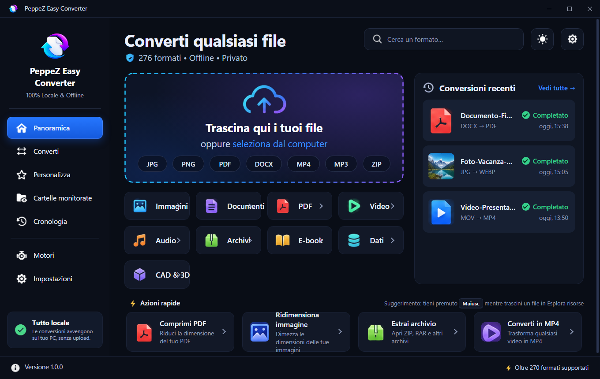
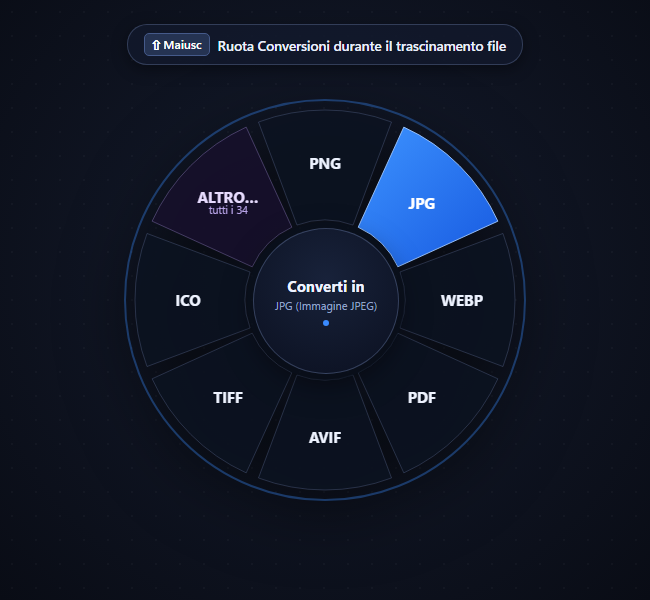
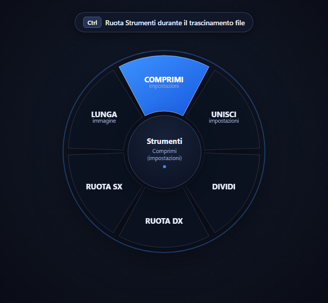

# 🔄 PeppeZ Easy Converter

<p align="center">
  
</p>

<p align="center">
  <b>Il convertitore offline universale per Windows con ruota radiale gestuale.</b><br>
  <i>Trascina un file tenendo premuto <kbd>Maiusc</kbd> o <kbd>Ctrl</kbd> e convertilo all'istante, direttamente da Esplora Risorse.</i>
</p>

<p align="center">
  
  
  
  
  
</p>

---

## 📸 Screenshot dell'Interfaccia

### 🖥️ Finestra Principale (Dashboard Dark Theme)
Interfaccia pulita, moderna e intuitiva con supporto drag & drop, ricerca istantanea tra oltre 270 formati, cronologia locale e azioni rapide:

<p align="center">
  
</p>

### 🎡 Ruote Radiali Globali (HUD Wheel in Esplora Risorse)
Trascina qualsiasi file ovunque su Windows e premi un tasto modificatore per far comparire la ruota attorno al cursore:

<table align="center" width="100%">
  <tr>
    <th width="50%" align="center"><b>⇧ Maiusc + Trascina: Ruota Conversioni</b></th>
    <th width="50%" align="center"><b>Ctrl + Trascina: Ruota Strumenti</b></th>
  </tr>
  <tr>
    <td align="center">
      <br>
      <i>7 formati preferiti + spicchio <b>ALTRO…</b> per l'elenco completo</i>
    </td>
    <td align="center">
      <br>
      <i>Strumenti veloci: Comprimi con stima MB, Unisci, Dividi, Ruota</i>
    </td>
  </tr>
</table>

---

## 📖 Indice

1. [Cos'è PeppeZ Easy Converter](#-cosè-peppez-easy-converter)
2. [Screenshot dell'Interfaccia](#-screenshot-dellinterfaccia)
3. [Funzionalità Chiave](#-funzionalità-chiave)
   - [Ruota Radiale Globale (HUD Wheel)](#-ruota-radiale-globale-hud-wheel)
   - [Architettura Intelligente a 7+1 Fette e HUD "ALTRO…"](#-architettura-intelligente-a-71-fette-e-hud-altro)
   - [Pannello Compressione con Stima MB Reale](#-pannello-compressione-con-stima-mb-reale)
   - [Unione PDF con Ordinamento Visivo](#-unione-pdf-con-ordinamento-visivo)
   - [Personalizzazione Totale della Ruota](#-personalizzazione-totale-della-ruota)
   - [Cartelle Monitorate (Watch Folders)](#-cartelle-monitorate-watch-folders)
   - [Motori Modulari Opzionali](#-motori-modulari-opzionali)
4. [Come si Usa](#-come-si-usa)
5. [Catalogo dei Motori di Conversione](#-catalogo-dei-motori-di-conversione)
6. [Download & Installazione](#-download--installazione)
7. [Architettura Tecnica](#-architettura-tecnica)
8. [Compilazione dai Sorgenti](#-compilazione-dai-sorgenti)
9. [Note su Privacy e Sicurezza](#-note-su-privacy-e-sicurezza)
10. [Licenza](#-licenza)

---

## 💡 Cos'è PeppeZ Easy Converter

**PeppeZ Easy Converter** è un'applicazione desktop moderna per Windows progettata per eliminare la complessità, l'attesa e i rischi di privacy della conversione dei file. Invece di aprire pesanti convertitori web o caricare documenti riservati online su server remoti, PeppeZ Easy Converter consente di eseguire qualsiasi conversione direttamente dal desktop o da Esplora Risorse:

* Tieni premuto il tasto sinistro su uno o più file e trascinali.
* Premi **<kbd>Maiusc</kbd>**: compare attorno al cursore la ruota con i formati di conversione compatibili per quel tipo di file.
* Premi **<kbd>Ctrl</kbd>**: compare la ruota degli strumenti rapidi (Comprimi, Unisci, Dividi, Ruota, Estrai...).
* Lascia il file sulla fetta desiderata: la copia convertita viene generata all'istante accanto all'originale o nella cartella di destinazione configurata.

Il programma supporta **oltre 270 formati** di immagini, documenti, PDF, video, tracce audio, libri digitali, archivi compressi, file CAD e dati tecnici.

---

## ✨ Funzionalità Chiave

### 🎡 Ruota Radiale Globale (HUD Wheel)
Una finestra trasparente frameless di 460x460 px compare istantaneamente attorno al cursore quando viene rilevato un trascinamento di file con tasto modificatore:
* **Posizionamento Intelligente**: se il file trascinato si trova vicino ai bordi dello schermo o in cima alla barra delle applicazioni, la ruota si sposta automaticamente verso l'interno e verso il basso (`area.y + 120px`), restando sempre interamente visibile e comodamente cliccabile.
* **Solo Conversioni Possibili**: propone esclusivamente i formati di destinazione realmente supportati per il tipo di file in trascinamento.

### 🎯 Architettura Intelligente a 7+1 Fette e HUD "ALTRO…"
Quando un formato supporta più di 8 destinazioni compatibili:
1. La ruota visualizza **7 spicchi con i formati principali o preferiti**.
2. L'8° spicchio si illumina in colore viola/ametista con l'etichetta **"ALTRO…"** e il conteggio dei formati disponibili.
3. Rilasciando il file su "ALTRO…", si apre un **mini-HUD interattivo** dotato di:
   * Barra di ricerca con filtro in tempo reale.
   * Griglia scorrevole con tutte le conversioni compatibili.
   * Selezione con un clic, doppio clic o tasto <kbd>Invio</kbd> per avviare subito la conversione.

### 📉 Pannello Compressione con Stima MB Reale
Rilasciando un'immagine o un file PDF sullo strumento **Comprimi**:
* Preset rapidi: **Forte (50%)**, **Media (75%)**, **Leggera (90%)** oppure slider libero da 10 a 100%.
* **Stima Reale in MB**: un motore di stima dedicato esegue in background una conversione di prova in una cartella temporanea isolata. L'anteprima calcola e mostra:
  $$\text{da } X\text{ MB } \rightarrow \sim Y\text{ MB } (-Z\%)$$
* **Calcolo Ottimizzato al Rilascio**: il ricalcolo della stima parte solo al termine del trascinamento dello slider, evitando rallentamenti durante la regolazione.
* **Compressione Dinamica PDF & Immagini**: per i PDF, il motore adatta la risoluzione DPI e la compressione Flate/JPEG in base alla percentuale scelta, producendo un risparmio effettivo e proporzionale.

### 📑 Unione PDF con Ordinamento Visivo
Trascinando due o più file PDF sullo strumento **Unisci**:
* Si apre una scheda ordinabile con l'elenco dei file.
* Con i pulsanti freccia su/giù è possibile modificare l'ordine esatto delle pagine prima di confermare.
* Con un solo file, l'unione si trasforma automaticamente in conversione rapida.

### 🛠️ Personalizzazione Totale della Ruota
Nella sezione **Personalizza** dell'app:
* Per ogni singolo formato o categoria, puoi decidere quali conversioni e quali strumenti mostrare nella ruota radiale.
* Se un formato ha più di 8 conversioni, puoi selezionare fino a **7 spicchi** (l'8° resta riservato ad **ALTRO…**).
* Puoi riordinare le fette in senso orario per mettere a portata di mano le conversioni che usi più di frequente.

### 📁 Cartelle Monitorate (Watch Folders)
* Configura una o più cartelle locali con una regola (es. qualsiasi file in entrata convertilo in PDF o JPG).
* Il programma lavora in background e converte automaticamente i nuovi file appena compaiono.

### 🧩 Motori Modulari Opzionali
All'avvio, PeppeZ Easy Converter dispone di un **motore base integrato** pronto all'uso per immagini, PDF e documenti. Dalla sezione **Motori** è possibile installare con un clic i motori specializzati per estendere le conversioni:
* **FFmpeg**: Video HD/4K, audio, estrazione tracce MP3 e GIF animate.
* **LibreOffice**: Word DOCX, Excel XLSX, PowerPoint PPTX in PDF ad altissima fedeltà.
* **Pandoc**: Markdown, LaTeX, Typst, HTML, Jupyter Notebook.
* **Calibre**: E-book per Kindle (MOBI, AZW3), Kobo (EPUB) e fumetti (CBZ, CBR).
* **Ghostscript**: Compressione PDF avanzata a livelli e grafica PostScript.
* **Tesseract OCR**: Trasforma scansioni e immagini in PDF ricercabili e testo TXT.
* **Whisper AI**: Trascrizione vocale locale e generazione automatica di sottotitoli (.srt).

---

## 🚀 Come si Usa

### Conversione con Ruota Radiale
1. Assicurati che l'app sia avviata (anche ridotta nella barra delle applicazioni).
2. Seleziona uno o più file sul Desktop o in Esplora Risorse.
3. Inizia a trascinarli con il mouse.
4. **Premi <kbd>Maiusc</kbd>** per i formati di conversione oppure **<kbd>Ctrl</kbd>** per gli strumenti veloci.
5. Rilascia il file sulla fetta desiderata.

### Conversione dalla Finestra Principale
1. Apri la schermata **Panoramica** o **Converti**.
2. Trascina i file nell'area di rilascio oppure usa il pulsante **Scegli file**.
3. Seleziona il formato e clicca **Avvia conversione**.

---

## 💻 Compilazione dai Sorgenti

### Requisiti
* **Node.js** (versione 18, 20 o 22 raccomandata)
* **Windows 10 / 11 a 64 bit**

### Passaggi

```bash
# 1. Clona il repository
git clone https://github.com/tuo-username/PeppeZ-Easy-Converter.git
cd PeppeZ-Easy-Converter

# 2. Installa le dipendenze
npm install

# 3. Avvia in modalità sviluppo
npm start

# 4. Crea l'eseguibile installer e portable (in dist/)
npm run build
```

---

## 🛡️ Note su Privacy e Sicurezza

* **100% Locale**: Nessun file, documento, immagine o testo viene mai inviato a server esterni o cloud.
* **Tutto sul tuo PC**: Le conversioni, i modelli di trascrizione vocale e i motori di elaborazione girano esclusivamente sulla tua CPU/GPU.
* **Sicurezza Totale**: I file temporanei di prova vengono isolati e cancellati immediatamente al termine dell'operazione.

---

## 📄 Licenza

Rilasciato sotto licenza open source **MIT**. Consulta il file `LICENSE` per tutti i dettagli.
